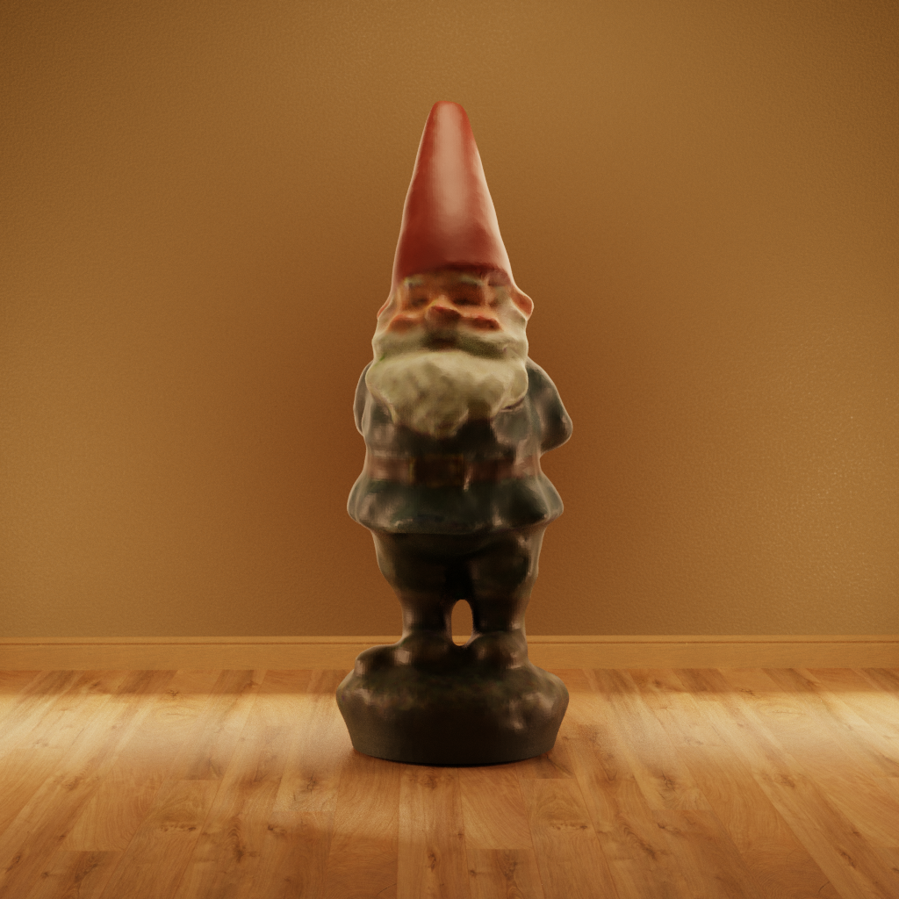
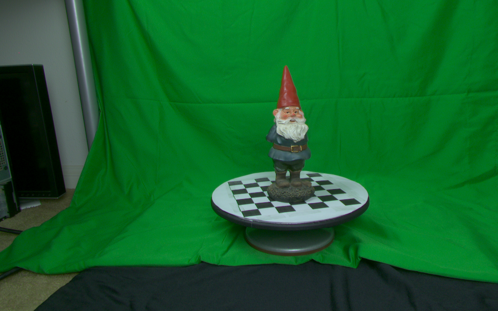

# 3D Model Reconstruction using Structured Illumination

This project implements a 3D model reconstruction pipeline using structured illumination. The pipeline includes the following steps:

1. **Camera Calibration**: Calibrates two cameras to obtain intrinsic and extrinsic parameters.
2. **Image Acquisition**: Captures images of the object under structured illumination, and in different orientations.
3. **Gray Code Extraction**: Extracts the gray code patterns from the captured images.
4. **3D Point Triangulation**: Triangulates the 3D points from the gray code patterns.
5. **Mesh Generation**: Generates a mesh from the triangulated points.
7. **Mesh Alignment**: Aligns the meshes from different orientations.

# Demo
### Gnome in a Field

### Gnome in a House

### Sample Scan


# Usage
To run the entire pipeline, execute the `main.py` script. This will perform camera calibration, image acquisition, gray code extraction, 3D point triangulation, mesh generation, and mesh alignment.

```bash
python main.py
```

Alternatively, you can run the script with command line arguments to specify which scan to process:

```bash
python main.py <scan_name> <number_of_scans>
e.g.: python main.py david 5
```

The resulting aligned meshes will be saved in the `meshes/` directory, and intermediate data will be stored in the `pickles/` directory.

# Scan File Requirements
The calibration scans should be stored in the `scans/calib/` directory. Each calibration scan should contain images of a checkerboard pattern, which will be used for camera calibration. 
- **File Naming**: The images should be named in the format `calib_<camera_id>_<frame_number>_u.png`, where `<camera_id>` is either `C0` or `C1`, and `<frame_number>` is a two-digit number (e.g., `00`, `01`, etc.).

The scans should be organized in the `scans/` directory, with each scan of an object in its own subdirectory. Each scan should contain the following:
- **Color Images**: These contain an image of the object as well as an image of the background for each camera. Each color image should be named in the format `color_<camera_id>_<frame_number>_c.png`, where `<camera_id>` is the identifier for the camera (`C0` or `C1`) and `<frame_number>` is the two-digit frame number (e.g., `00` or `01`). `00` represents the background image, and `01` represents the object image.
- **Structured Illumination Images**: These are images of each pattern of the gray code. Each structured illumination image should be named in the format `frame_<camera_id>_<frame_number>_u.png`, where `<camera_id>` is the identifier for the camera (`C0` or `C1`) and `<frame_number>` is the two-digit frame number (e.g., `00`, `01`, etc.).

# Folder Structure
```
├── meshes/             # Contains generated meshes
│
├── pickles/            # Contains pickled data for intermediate steps
│   ├── alignment       
│   ├── calibration
│   ├── graycode
│   ├── mesh
│   └── reconstruction
│
├── scans/              # Contains raw scans
│   ├── calib           # Checkerboard images for calibration
│   └── david           # Scans of "David" the gnome
│       ├── grab_0
│       ├── grab_1
│       ├── grab_2
│       ├── grab_3
│       └── grab_4
│
├── src/                # Source code for the project
│   ├── align.py        # Mesh alignment
│   ├── calibrate.py    # Camera calibration
│   ├── camutils.py     # Camera utility functions and classes
│   ├── decode.py       # Gray code decoding
│   ├── mesh.py         # Mesh generation
│   ├── reconstruct.py  # 3D point reconstruction
│   └── visualize.py    # Visualization intermediate steps
│
├── .gitignore
├── main.py             # Main script to run the pipeline
└── README.md
```